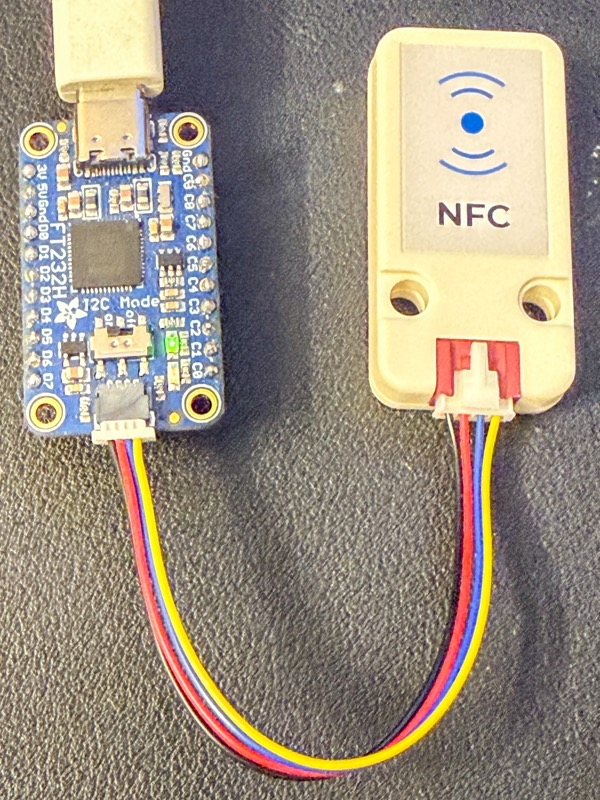
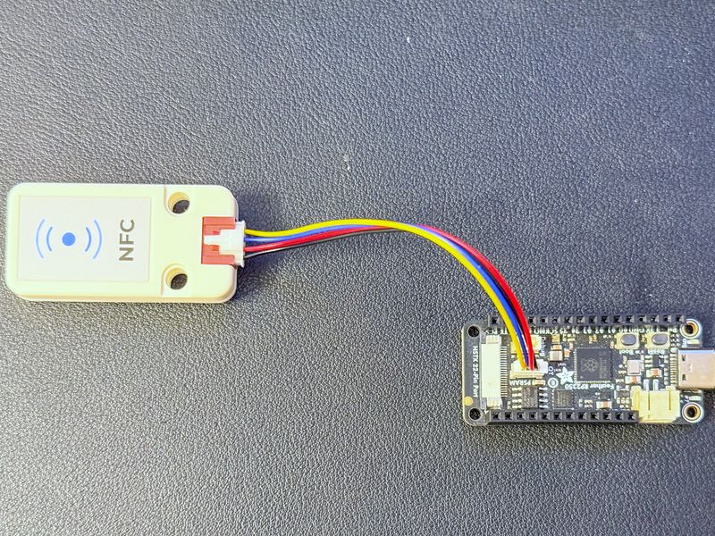

# M5Stack NFC unit (ST25R3916): read and write NTAG215 tags

Five ways to read and write NTAG215 NFC tags with an [M5Stack NFC Universal Unit (ST25R3916)](https://shop.m5stack.com/products/nfc-universal-unit-st25r3916), a small I2C module with a 13.56 MHz antenna:

| Folder | Setup | You use it as |
|---|---|---|
| [`python/`](python) | Mac, FT232H breakout, the unit | a command-line tool |
| [`micropython/`](micropython) | Feather RP2350 running MicroPython, the unit | a USB smart-card (PC/SC) reader |
| [`arduino/`](arduino) | Feather RP2350 running Arduino-Pico firmware, the unit | a USB smart-card (PC/SC) reader and a serial command line |
| [`tinygo/`](tinygo) | Feather RP2350 running TinyGo (Go) firmware, the unit | a USB smart-card (PC/SC) reader and a serial command line |
| [`rust/`](rust) | Feather RP2350 running Rust (Embassy) firmware, the unit | a USB smart-card (PC/SC) reader and a serial command line |

```
python/        Mac --USB--> FT232H ----------I2C--+
micropython/   Mac --USB--> Feather RP2350 --I2C--+--> M5Stack NFC unit --13.56 MHz--> NTAG215 tag
arduino/       Mac --USB--> Feather RP2350 --I2C--+
tinygo/        Mac --USB--> Feather RP2350 --I2C--+
rust/          Mac --USB--> Feather RP2350 --I2C--+
```

| `python/`: FT232H and the unit | `micropython/`, `arduino/`, `tinygo/`, `rust/`: Feather RP2350 and the unit |
|---|---|
|  |  |

The four Feather variants present a standard CCID reader, so the Mac needs no custom driver: `pyscard`, OpenSC, `pcsctest` and `system_profiler` all work with them.

## What all five do

- Find a tag and print its UID, ATQA and SAK, and tell whether it is an NTAG215.
- Dump all 135 pages (4 bytes each).
- Read and write NDEF text and URI records. A phone (iPhone, NFC Tools) reads the records written by `python/` and `arduino/`; the `micropython/`, `tinygo/` and `rust/` records have not been checked with a phone.
- Write single pages, and read each one back to verify it.
- Refuse writes to the UID, lock bytes, capability container and configuration pages unless forced. Those bits are one-way, so use a spare tag if you experiment with them.

## Shared interface

The goal is the same functionality in every implementation: the same command set, the same output and the same PC/SC behaviour. This section is that target; the last table says which pieces each folder has today. `python/` has no PC/SC side because the FT232H is an I2C adapter, not a reader.

### Commands (`python/`: `python -m nfc.cli <command>`; the Feather variants: type the command on the USB serial port at 115200 baud)

Every command on the serial port ends with a line `ok` or `error: <reason>`.

| Command | What it does | Output |
|---|---|---|
| `chip` | Checks that the ST25R3916 answers. | `ST25R3916 present: type=0x05 revision=2` |
| `detect` | Finds a card. | `UID:  04:64:31:66:D3:2A:81`, `ATQA: 4400  SAK: 0x00`, then `Type: NTAG215`, or for an ISO-DEP card `Type: ISO-DEP card (ISO 14443-4); try desfire` |
| `dump` | All 135 pages of an NTAG215. | one line per page: number, 4 hex bytes, ASCII |
| `read-ndef` | Decodes the NDEF message. | `text[en]: hello`, `uri: https://example.com`, or `no NDEF message` |
| `write-ndef [--text T] [--lang L] [--uri U]` | Writes text and/or URI records. | `wrote N page(s)` (pages that already match are skipped) |
| `write-page <page> <8 hex> [--force]` | Writes one page and reads it back. | `page 20 = 52555354 (verified where readable)` |
| `cycles [N]` | N rounds of select and full dump, compared with the first. | `50/50 cycles OK; per cycle avg 167 ms, max 168 ms` |
| `ident` | NTAG identification: `GET_VERSION` (NTAG21x datasheet 10.1), `READ_SIG` (10.8), `READ_CNT` (10.6). | `Version: 00 04 04 02 01 00 11 03`, `Type: NTAG215 (NXP)`, `Signature: <64 hex digits>`, `Counter: 0` or `Counter: not readable (NAK)` |
| `desfire` | ISO-DEP identification of a DESFire card, no keys. | `UID`, `ATQA`/`SAK`, `ATS:  06 75 77 81 02 80`, `Version: HW 1.0 SW 1.4 vendor 0x04 type 0x01 storage 4096 bytes`, `Card UID`, the `GET_VERSION` and `GET_APPLICATION_IDS` status words, one `AID` line per application |
| `help` | Lists the commands. | |

Allowed to differ: developer conveniences such as `bootsel` (Rust).

### PC/SC reader (Feather variants)

The reader presents a CCID device. The ATR is `3B 8F 80 01 80 4F 0C A0 00 00 03 06 03 00 03 00 00 00 00 68` for Type 2 tags, and for an ISO-DEP card it is built from the card's ATS (`3B 81 80 01 80 80` for a DESFire EV1). Card insert and remove events are sent.

| APDU | Meaning | Reply |
|---|---|---|
| `FF CA 00 00 <Le>` | UID (answered by the reader, for any card) | UID + `90 00` |
| `FF B0 00 <page> <Le>` | Read `Le` bytes from `page` (`Le` = 0 reads 16), up to 255 | data + `90 00` |
| `FF D6 00 <page> 04 <4 bytes>` | Write one page, then read it back | `90 00` |
| `FF 60 00 00 00` | NTAG `GET_VERSION` | 8 bytes + `90 00` |
| `FF 3C 00 00 00` | NTAG `READ_SIG` | 32 bytes + `90 00` |
| `FF 39 00 02 00` | NTAG `READ_CNT` | 3 bytes (counter, low byte first) + `90 00` |
| anything else, card is ISO-DEP | passed to the card unchanged; the card's reply and status words come back | card's reply |

The code after `FF` is the native command code. Status words: `6A 82` page out of range or the tag refused the page address (NAK `0h`); `69 82` write refused (UID, lock bytes, capability container, configuration, password pages); `65 81` memory failure (any other NAK, or a failed read-back); `67 00` wrong length; `6B 00` bad P1/P2; `6A 81` the tag does not support the command or refused it with a NAK (`ident` APDUs); `6D 00` unknown instruction; `6E 00` unknown class (Type 2 tags). If a Type 2 tag does not answer an `ident` APDU, the reader reselects it: a tag that still answers gives `6A 81`, a missing tag is reported absent.

### What each folder has today

| | `python/` | `micropython/` | `arduino/` | `tinygo/` | `rust/` |
|---|---|---|---|---|---|
| `chip`, `detect`, `dump`, `read-ndef`, `write-ndef`, `write-page` | yes | no serial command line | yes | yes | yes |
| `cycles` | no | no | yes | yes | yes |
| `ident` and the `FF 60/3C/39` APDUs | no | no | yes | no | yes |
| `desfire` | no | no | yes | no | yes |
| `FF CA`, `FF B0`, `FF D6` | n/a | yes | yes | yes | yes |
| ISO-DEP pass-through, ATR from the ATS | n/a | no | yes | no | yes |
| `FF CA` answered by the reader for ISO-DEP cards | n/a | no | yes | no | yes |
| Insert and remove events | n/a | yes | yes | yes | yes (not while an ISO-DEP session is open) |
| Same `UID` format everywhere (colons) | yes | n/a | yes | yes | yes |

## Comparison

| | `python/` | `micropython/` | `arduino/` | `tinygo/` | `rust/` |
|---|---|---|---|---|---|
| Runs on | Mac (Python 3.10+, `uv`) | Feather RP2350, MicroPython | Feather RP2350, Arduino-Pico (C++, PlatformIO) | Feather RP2350, TinyGo (Go) | Feather RP2350, Rust (Embassy, Cargo) |
| Talks to the unit through | FT232H via `pyftdi` | the Feather's Qwiic port (I2C1) | the Feather's Qwiic port (I2C1) | the Feather's Qwiic port (I2C1) | the Feather's Qwiic port (I2C1), driver crate `rnfc-st25r39` |
| Extra hardware | FT232H breakout | Qwiic cable | Qwiic cable | Qwiic cable | Qwiic cable |
| Interface to the Mac | CLI: `python -m nfc.cli` | USB PC/SC reader | USB PC/SC reader and serial CLI | USB PC/SC reader and serial CLI | USB PC/SC reader and serial CLI |
| Commands | `chip`, `detect`, `dump`, `read-ndef`, `write-ndef`, `write-page` | pseudo-APDUs `FF CA` (UID), `FF B0` (read), `FF D6` (write) | the same pseudo-APDUs, and the serial CLI: the `python/` commands plus `cycles` | the same pseudo-APDUs, and the same serial CLI as `arduino/` | the same pseudo-APDUs and serial CLI as `arduino/`, plus DESFire APDU pass-through and a `desfire` command |
| Live card insert and remove events | no | yes | yes | yes | yes |
| Full 135-page dump | about 7 s | not measured | about 180 ms | about 184 ms | about 167 ms |
| Longest read per command | n/a | 48 bytes tested | 255 bytes | 255 bytes | 255 bytes |
| Tests | 13, against a software fake chip | 11, for the CCID message layer | host test for the CCID message layer; `cycles` on hardware | host tests for NDEF, CRC and the CCID message layer; `cycles` on hardware | 11 host tests (CCID layer, NDEF, guards, parsing); `cycles` on hardware |
| Reliability run | 50 of 50 dumps | not run | 50 of 50 dumps | 50 of 50 dumps | 50 of 50 dumps |
| Easiest to change | yes: a script on the Mac | yes: Python on the board, no build | needs a PlatformIO build | needs TinyGo and a copy to the BOOTSEL drive | needs Rust, picotool and a first BOOTSEL; the chip driver is a dependency, not code to edit |

How to choose:

- **`python/`** if you want to script tag access from the Mac and have an FT232H.
- **`micropython/`**, **`arduino/`**, **`tinygo/`** or **`rust/`** if you want a USB reader that any PC/SC software can use. `arduino/` is faster, handles longer reads and adds the serial command line; `micropython/` is quicker to modify; `tinygo/` is the same as `arduino/` written in Go; `rust/` is the same again in Rust, and the only one that reuses a published chip driver instead of porting one.
- Only one firmware can be on a Feather at a time. Switching between `micropython/`, `arduino/`, `tinygo/` and `rust/` means flashing the board again; each README says how.

## Supported tags and limits

- Reading and writing work for NTAG215 and other Type 2 tags with 4- or 7-byte UIDs. Only NTAG215 has been tested.
- Other ISO 14443-A cards are detected (UID, ATQA, SAK) but their content cannot be read. DESFire cards, such as an ORCA card, need an ISO-DEP layer: only `rust/` has one (it identifies the card and passes unauthenticated commands through; file contents need keys).
- The unit is powered from the Feather's Qwiic 3.3V, or from 5V with the FT232H. Read range was tested only with a tag lying on the unit.

## Getting started

Pick a folder and follow its README: it lists the hardware, the wiring, the setup and a check that everything works.

- [`python/README.md`](python/README.md)
- [`micropython/README.md`](micropython/README.md)
- [`arduino/README.md`](arduino/README.md)
- [`tinygo/README.md`](tinygo/README.md)
- [`rust/README.md`](rust/README.md)

## Hardware

- [M5Stack NFC Universal Unit (ST25R3916)](https://shop.m5stack.com/products/nfc-universal-unit-st25r3916): I2C address 0x50, runs from 5V with its own 3.3V regulator and I2C pull-ups
- [Adafruit FT232H breakout](https://shop.adafruit.com/products/2266) for `python/`
- Adafruit Feather RP2350 (the PSRAM/HSTX model) for `micropython/`, `arduino/`, `tinygo/` and `rust/`
- NTAG215 tags

## License

[MIT](LICENSE).
