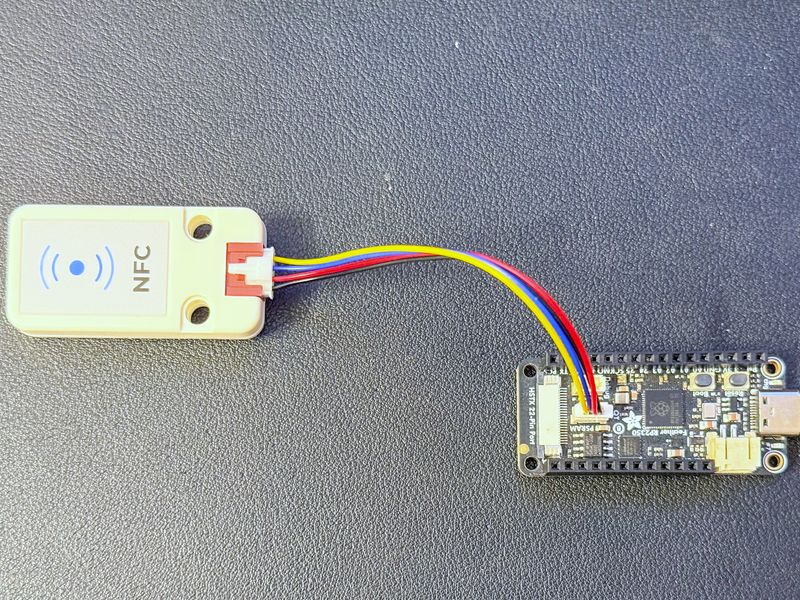

# arduino: USB NFC reader and serial tool on a Feather RP2350

C++ firmware (Arduino-Pico, built with PlatformIO) for an Adafruit Feather RP2350 and an M5Stack NFC Universal Unit (ST25R3916). It does two things at once over the Feather's USB cable:

- **A USB smart-card (CCID) reader.** The Mac sees a standard PC/SC reader, so `pyscard`, OpenSC, `pcsctest` and `system_profiler` work with no custom software.
- **A serial command line** (`chip`, `detect`, `dump`, `read-ndef`, `write-ndef`, `write-page`, `cycles`) for working with a tag directly.

```
Mac --USB: CCID reader + serial--> Feather RP2350 --I2C (Qwiic)--> M5Stack NFC unit --13.56 MHz--> NTAG215 tag
```

## What you need

- Adafruit Feather RP2350 (the PSRAM/HSTX model) and a USB cable
- [M5Stack NFC Universal Unit (ST25R3916)](https://shop.m5stack.com/products/nfc-universal-unit-st25r3916), SKU U216
- A Qwiic / STEMMA QT cable to connect them
- NTAG215 tags
- On the Mac: [PlatformIO](https://platformio.org/) (`pio`). For the tests: a C++ compiler, [uv](https://docs.astral.sh/uv/), and optionally `brew install opensc`

## Wiring




Plug the unit into the Feather's Qwiic (STEMMA QT) port. That gives SDA, SCL and GND, plus 3.3V on the unit's power pin, and the unit runs from it. The unit has an on-board regulator and pull-ups to its own 3.3V rail, so no level shifter is needed. Only a tag lying on the unit has been tested for read range.

In Arduino, the Qwiic port is `Wire` (I2C1, SDA GP2, SCL GP3), already the default pins. Do not use `Wire1` on this board: it is I2C0 on an unconnected pin, and `Wire1.setSDA(2)` panics and hangs the board.

## Build and flash

The board is `adafruit_feather_rp2350_hstx` (CircuitPython calls the same board `adafruit_feather_rp2350`), using the Arduino-Pico core through the maxgerhardt PlatformIO platform.

```
pio run                # build; the first build downloads the toolchain (about 2 minutes)
pio run -t upload      # flash; picotool reboots the board into its bootloader by itself
```

If the board is hung or still runs MicroPython, put it in the bootloader by hand: hold BOOTSEL while plugging in, release after a second, and the `RP2350` drive appears. Then run `pio run -t upload`. From MicroPython, `mpremote exec "import machine; machine.bootloader()"` does the same.

## Use it

### As a PC/SC reader

After power-up the Mac lists a reader named `Experiment NFC CCID reader`. It starts answering once the 3-second start-up delay has passed:

```
system_profiler SPSmartCardsDataType      # lists the reader, with the card's ATR
/usr/bin/pcsctest                         # macOS's own PC/SC test program
uv run --with pyscard python ../micropython/pcsc_check.py
opensc-tool -s FFCA000000                 # UID through OpenSC
```

The card's ATR is the standard PC/SC contactless ATR for Ultralight-family tags: `3B 8F 80 01 80 4F 0C A0 00 00 03 06 03 00 03 00 00 00 00 68`. The reader tells the Mac when a card appears or disappears, so PC/SC applications get live insert and remove events.

| APDU | Meaning | Reply |
|---|---|---|
| `FF CA 00 00 <Le>` | UID (`Le` = 0 returns all of it) | UID + `90 00` |
| `FF B0 00 <page> <Le>` | Read `Le` bytes from `page` (`Le` = 0 reads 16), up to 255 | data + `90 00` |
| `FF D6 00 <page> 04 <4 bytes>` | Write one page, then read it back to verify | `90 00` |
| `FF 60 00 00 00` | NTAG `GET_VERSION` | 8 bytes + `90 00` |
| `FF 3C 00 00 00` | NTAG `READ_SIG` | 32 bytes + `90 00` |
| `FF 39 00 02 00` | NTAG `READ_CNT` | 3 bytes + `90 00`, or `6A 81` if the tag refuses |
| anything else, card is ISO-DEP | passed to the card unchanged; the card's reply and status words come back | card's reply |

For an ISO-DEP card (a DESFire card, for example) power-on also runs RATS and answers with an ATR built from the card's ATS (`3B 81 80 01 80 80` for a DESFire EV1). The card then stays activated between APDUs, so DESFire native commands wrapped as `90 INS 00 00 00` work, including the "additional frame" chain across separate commands. `FF CA` is still answered by the reader, with the UID:

```
opensc-tool -s 9060000000 -s 90AF000000 -s 90AF000000    # GET_VERSION in three frames
```

A serial command that selects the card (`detect`, `dump`, `desfire` and the rest) resets the RF field and ends that session; the next PC/SC command then fails and the host has to connect again. While an ISO-DEP card is powered the reader does not probe for it, so a removed card is noticed on the next command instead of through a slot-change event. Only unauthenticated commands were tried; there is no key handling.

Status words other than success: `6A 82` page out of range (or the tag refused the page address), `6A 81` the tag refused an `ident` command or does not support it, `69 82` write refused (UID, lock bytes, capability container, configuration and password pages), `65 81` memory failure (a failed read-back or any other NAK from the tag), `67 00` wrong length, `6B 00` bad P1/P2, `6D 00` unknown instruction, `6E 00` unknown class. User memory is pages 4 to 129.

### As a serial command line

Open the Feather's USB serial port at 115200 baud (`pio device monitor`, or any terminal). The board waits 3 seconds after power-up. Type one command per line; every command ends with a line `ok` or `error: ...`.

| Command | What it does |
|---|---|
| `chip` | Checks that the ST25R3916 answers and prints its type and revision. |
| `detect` | Finds a card and prints its UID, ATQA and SAK, and whether it is an NTAG215. |
| `dump` | Prints all 135 pages (4 bytes each) as hex and ASCII. |
| `read-ndef` | Decodes the NDEF message: text and URI records. |
| `write-ndef [--text "T"] [--lang L] [--uri U]` | Writes a text and/or URI record, replacing the current message. Pages that already match are skipped. |
| `write-page <page> <8 hex digits> [--force]` | Writes one 4-byte page and reads it back to verify. |
| `ident` | NTAG identification: `GET_VERSION`, `READ_SIG` and `READ_CNT` (NTAG21x datasheet 10.1, 10.8, 10.6). Prints the version bytes, the type, the signature and the counter, or `Counter: not readable (NAK)`. A tag that does not answer a command is selected again: if it still answers, the command is reported as refused. |
| `desfire` | Identifies a DESFire card (ISO 14443-4) without keys: ATS, `GET_VERSION` (hardware and software version, storage size, UID, production date) and `GET_APPLICATION_IDS`, with the status words. `detect` points ISO-DEP cards to it. |
| `cycles [N]` | Runs N (default 50) rounds of select and full dump and compares each dump with the first. |
| `help` | Lists the commands. |

```
detect
UID:  04:64:31:66:D3:2A:81
ATQA: 4400  SAK: 0x00
Type: NTAG215
ok
```

Pages outside the user memory (4 to 129), such as the UID, lock bytes, capability container (page 3) and configuration, are refused unless you pass `--force`. Their bits are one-way: a lock bit cannot be cleared again. Use a spare tag when you experiment with them.

A full dump takes about 180 ms (`cycles` reports it). The serial commands and the PC/SC reader share the chip: a long command such as `cycles` delays PC/SC answers while it runs.

## Source layout (`src/`)

| File | Role |
|---|---|
| `St25r3916.h/.cpp` | The chip driver: registers, FIFO, direct commands, initialisation, field control, `transceive`. Talks to a `Transport`, not to `Wire`, and returns status codes instead of throwing. |
| `Nfca.h/.cpp` | ISO 14443-A: CRC_A, WUPA, anticollision, select (4- and 7-byte UIDs), Type 2 READ and WRITE. |
| `IsoDep.h/.cpp` | ISO 14443-4 block protocol: RATS, I-block framing, chaining, waiting-time extension, retries, deselect. Ported from embassy-rs/rnfc and tested against the ISO 14443-4 Annex B scenarios (`test/test_isodep.cpp`). No Arduino dependency. |
| `Desfire.h` | DESFire commands wrapped as `90 INS 00 00 00`, following "additional frame" replies. |
| `Ntag215.h/.cpp` | The tag's memory model: 135 pages, write guards with read-back verify, NDEF read and write. |
| `Ndef.h/.cpp` | NDEF text and URI records and the TLV wrapper. No heap: callers provide the buffers. |
| `WireTransport.h` | The Arduino `Wire` transport. |
| `Cli.h/.cpp` | The serial command line. |
| `CcidProto.h/.cpp` | CCID message handling: slot status, power on and off, transfer blocks, parameters. Plain C++ with no Arduino dependency. |
| `NfcBackend.h/.cpp` | Maps the pseudo-APDUs above onto the tag. |
| `CcidDriver.h/.cpp` | The USB CCID class driver for TinyUSB. |
| `main.cpp` | Registers the CCID interface in `initVariant()`, starts the chip, and runs the serial command line and the CCID service from `loop()`. |

Behaviour of the chip worth knowing:

- After a checked receive, the chip leaves the CRC_A bytes in its FIFO. `transceive` strips them when they match, so receive buffers need two spare bytes.
- A tag's 4-bit write acknowledgement trips the chip's CRC and parity flags. The write path ignores those flags for that one frame, but accepts the reply only if it is exactly one byte ending in an incomplete byte (the chip's `fifo_lb` field is non-zero). That is the rule ST's RFAL library uses; the reply format is defined in the NTAG21x datasheet, section 9.3.
- A tag that is already selected ignores WUPA until the field is power-cycled. `selectCard` resets the field and retries once when WUPA gets no answer, so repeated selects work.

### How the USB CCID reader works

TinyUSB has no CCID class, so `CcidDriver.cpp` adds one:

- It defines `usbd_app_driver_get_cb()`, which TinyUSB calls to find application class drivers. The Arduino-Pico core defines that function only when `ENABLE_PICOTOOL_USB` is set, which it is not in this build; if you turn that flag on, the two definitions clash.
- It adds the CCID interface descriptor next to the USB serial one through `USB.registerInterface()`.
- `ccidBegin()` must run from `initVariant()`. The core's `main()` runs `USB.begin()` and `Serial.begin()` before `setup()`, so a registration made in `setup()` is ignored: the Mac would see only the serial port.
- USB callbacks run in the TinyUSB task, so they only record that a command arrived. `ccidService()`, called from `loop()`, does the NFC work over I2C and sends the reply under the core's USB lock. It also polls for a card every 300 ms and sends a slot-change notification when one appears or disappears.
- A reply whose length is an exact multiple of 64 bytes ends with a zero-length packet.

## Tests

On the Mac, no hardware needed:

```
./test/run.sh          # CCID message layer: builds test/test_ccid_proto.cpp with the system C++ compiler
```

With the board flashed and a tag on the unit, use the PC/SC scripts in [`../micropython`](../micropython), which work with either reader (run each as `uv run --with pyscard python <script>`):

| Script | What it checks |
|---|---|
| `pcsc_check.py` | ATR, UID, page reads, and that a write to the capability container is refused. |
| `pcsc_monitor.py [seconds]` | Prints card insert and remove events live; lift and replace the tag while it runs. |
| `pcsc_ndef_roundtrip.py` | Writes a text and a URI record with `FF D6`, reads them back with `FF B0`, then restores the original records. |

The serial `cycles` command is the reliability check: 50 of 50 rounds of select and full dump pass.

## Limits

- Type 2 tags (NTAG, Ultralight) can be read and written. DESFire cards can be identified with `desfire` and passed through the PC/SC reader (no keys, so no file contents).
- The first PC/SC answers wait for the 3-second start-up delay.
- Only one firmware can be on the Feather at a time. [`../micropython`](../micropython) builds the same reader in MicroPython and replaces this one on the board.

## Same functionality elsewhere in this repo

[`../python`](../python) is the same tag tool for the Mac, using an FT232H breakout instead of a Feather.
