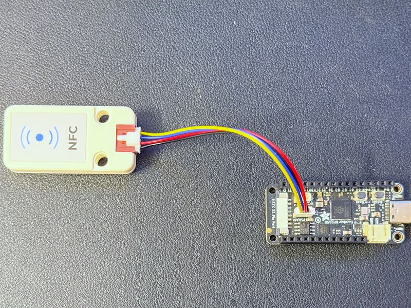

# micropython: USB NFC reader (PC/SC) and serial tool on a Feather RP2350

MicroPython firmware that turns an Adafruit Feather RP2350 and an M5Stack NFC Universal Unit (ST25R3916) into a USB smart-card (CCID) reader and a serial command line. The Mac sees a standard PC/SC reader, so existing tools work with no custom software: `pyscard`, OpenSC, `pcsctest`, `system_profiler`. The board's USB serial port takes the same commands as the other variants (`chip`, `detect`, `dump`, `read-ndef`, `write-ndef`, `write-page`, `ident`, `cycles`).

```
Mac --USB (CCID / PC/SC + serial)--> Feather RP2350 --I2C (Qwiic)--> M5Stack NFC unit --13.56 MHz--> NTAG215 tag
```

## What you need

- Adafruit Feather RP2350 (the PSRAM/HSTX model) and a USB cable
- [M5Stack NFC Universal Unit (ST25R3916)](https://shop.m5stack.com/products/nfc-universal-unit-st25r3916), SKU U216
- A Qwiic / STEMMA QT cable to connect them
- NTAG215 tags
- On the Mac: [uv](https://docs.astral.sh/uv/) and `mpremote` (`uv tool install mpremote`)

## Wiring




Plug the unit into the Feather's Qwiic (STEMMA QT) port. That gives SDA, SCL and GND, plus 3.3V on the unit's power pin. The Qwiic port is I2C1 on GP2 (SDA) and GP3 (SCL).

The unit has an on-board regulator and pull-ups to its own 3.3V rail, and it runs from the Qwiic port's 3.3V. Only a tag lying on the unit has been tested for read range. If you need more range, the unit's 5V pin can instead be fed from the Feather's `USB` pin; that has not been tried.

## Install

1. Flash MicroPython. Hold BOOTSEL while plugging the Feather in, then copy the Feather RP2350 firmware from <https://micropython.org/download/ADAFRUIT_FEATHER_RP2350/> onto the `RP2350` drive (tested with v1.29.0).
2. Install the USB device library. The Mac downloads it and copies it over, so the board needs no network:
   ```
   mpremote mip install usb-device
   ```
3. From this folder, copy the files to the board:
   ```
   rm -rf nfc/__pycache__      # host caches from running the tests; they only waste board flash
   mpremote cp -r nfc :
   mpremote cp main.py ccid_proto.py nfc_backend.py ccid_reader.py cli.py :
   ```
4. Unplug and replug the Feather. About 4 seconds later the Mac lists a reader named `Experiment NFC CCID reader`.

## Use it from the Mac

With a tag on the unit:

```
system_profiler SPSmartCardsDataType      # lists the reader, with the card's ATR
/usr/bin/pcsctest                         # macOS's own PC/SC test program
uv run --with pyscard python pcsc_check.py
brew install opensc && opensc-tool -s FFCA000000
```

The card's ATR is the standard PC/SC contactless ATR for Ultralight-family tags: `3B 8F 80 01 80 4F 0C A0 00 00 03 06 03 00 03 00 00 00 00 68`. The reader tells the Mac when a card appears or disappears, so PC/SC applications get live insert and remove events.

### As a serial command line

Open the board's USB serial port at 115200 baud (the reader and the console share one cable). After the 4-second start-up window the commands are available; type one per line and every command ends with `ok` or `error: ...`:

| Command | What it does |
|---|---|
| `chip` | Checks that the ST25R3916 answers. |
| `detect` | Finds a card and prints UID, ATQA and SAK; says `Type: NTAG215`, or that an ISO-DEP card needs `desfire`. |
| `dump` | Prints all 135 pages. |
| `read-ndef` | Decodes the NDEF message. |
| `write-ndef [--text T] [--lang L] [--uri U]` | Writes text and/or URI records. |
| `write-page <page> <8 hex> [--force]` | Writes one page and reads it back. |
| `ident` | NTAG identification: `GET_VERSION`, `READ_SIG`, `READ_CNT` (NTAG21x datasheet 10.1, 10.8, 10.6). Prints the version bytes, the type, the signature and the counter, or `Counter: not readable (NAK)`. A tag that does not answer is selected again: if it still answers the command is reported as refused. |
| `cycles [N]` | N rounds of select and full dump (a full dump takes about 260 ms here). |

The commands and their output are the same as in the other variants (see the shared interface in the top-level README); error texts for refused pages come from the Python driver and read differently. The commands share the chip with the PC/SC reader: a long command such as `cycles` delays PC/SC answers, and a command that selects the card resets the RF field. The REPL is not available while the reader runs, and Ctrl-C is switched off so a stray key cannot stop the reader.

### Commands (pseudo-APDUs)

| APDU | Meaning | Reply |
|---|---|---|
| `FF CA 00 00 <Le>` | UID (`Le` = 0 returns all of it) | UID + `90 00` |
| `FF B0 00 <page> <Le>` | Read `Le` bytes from `page` (`Le` = 0 reads 16) | data + `90 00` |
| `FF D6 00 <page> 04 <4 bytes>` | Write one page, then read it back to verify | `90 00` |
| `FF 60 00 00 00` | NTAG `GET_VERSION` | 8 bytes + `90 00` |
| `FF 3C 00 00 00` | NTAG `READ_SIG` | 32 bytes + `90 00` |
| `FF 39 00 02 00` | NTAG `READ_CNT` | 3 bytes + `90 00`, or `6A 81` if the tag refuses |

Status words other than success: `6A 82` page out of range (or the tag refused the page address), `6A 81` the tag refused an `ident` command or does not support it, `69 82` write refused (UID, lock bytes, capability container, configuration and password pages), `65 81` memory failure (a failed read-back or any other NAK from the tag), `67 00` wrong length, `6B 00` bad P1/P2, `6D 00` unknown instruction, `6E 00` unknown class. User memory is pages 4 to 129.

Reads of up to 48 bytes per command are tested.

## Boot and recovery

`main.py` waits 4 seconds and then starts the reader. While the reader runs, the board's USB serial port carries the command line instead of the REPL, so `mpremote` cannot reach it. Ways back in:

- During the 4-second window the REPL is still up: run `mpremote exec "..."` right after plugging in and it interrupts `main.py`.
- Or hold BOOTSEL for about 3 seconds right after plugging in. `main.py` then skips the reader and leaves the REPL up.

Do not hold BOOTSEL at the moment of plugging in: that enters the ROM bootloader instead, and the `RP2350` drive appears.

Errors in the reader loop are appended to `/ccid.log` on the board.

To try the reader without `main.py`, copy the files except `main.py`, then run `mpremote exec "import run_reader"`. The reader starts from RAM, and a replug brings the REPL back.

With the REPL available, `mpremote run nfc_check.py` prints the chip identity, the tag's UID and NDEF records, and the first pages, without the USB reader.

Only one firmware can be on the Feather at a time. [`../arduino`](../arduino) builds the same reader as C++ firmware and replaces this one on the board. To come back, repeat the install steps.

## Files

| File | Role |
|---|---|
| `main.py` | Boot script: 4-second window, then starts the reader. |
| `ccid_reader.py` | USB CCID interface and the main loop. All NFC and I2C work runs in the loop, never in USB callbacks. |
| `ccid_proto.py` | CCID message handling: slot status, power on and off, transfer blocks, parameters. Independent of USB and the chip. |
| `nfc_backend.py` | Maps the pseudo-APDUs above onto the tag. |
| `nfc/` | The ST25R3916 driver and tag layers: `transport.py` (`machine.I2C`), `st25r3916.py`, `nfca.py`, `ntag215.py`, `ndef.py`. |
| `run_reader.py` | Starts the reader from RAM, without `main.py`. |
| `nfc_check.py` | Hardware check over the REPL. |
| `host_check.py`, `pcsc_check.py`, `pcsc_monitor.py`, `pcsc_ndef_roundtrip.py` | Mac-side PC/SC scripts, below. |
| `tests/` | Host tests for `ccid_proto.py`. |

## Tests

On the Mac, no hardware needed:

```
uv run --with pytest python -m pytest tests -q      # 11 tests of the CCID message layer
```

With the reader running and a tag on the unit (run each as `uv run --with pyscard python <script>`):

| Script | What it checks |
|---|---|
| `host_check.py` | The reader is listed. |
| `pcsc_check.py` | ATR, UID, page reads, and that a write to the capability container is refused. |
| `pcsc_monitor.py [seconds]` | Prints card insert and remove events live; lift and replace the tag while it runs. |
| `pcsc_ndef_roundtrip.py` | Writes a text and a URI record with `FF D6`, reads them back with `FF B0`, then restores the original records. |

## Limits

- Type 2 tags (NTAG, Ultralight) only. Other cards are detected but not readable; DESFire needs an ISO-DEP layer that is not implemented.
- Reads longer than 48 bytes per command are untested here. The Arduino build handles up to 255.
- The REPL is off while the reader runs (see Boot and recovery).
