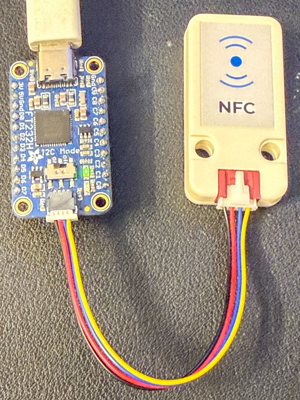
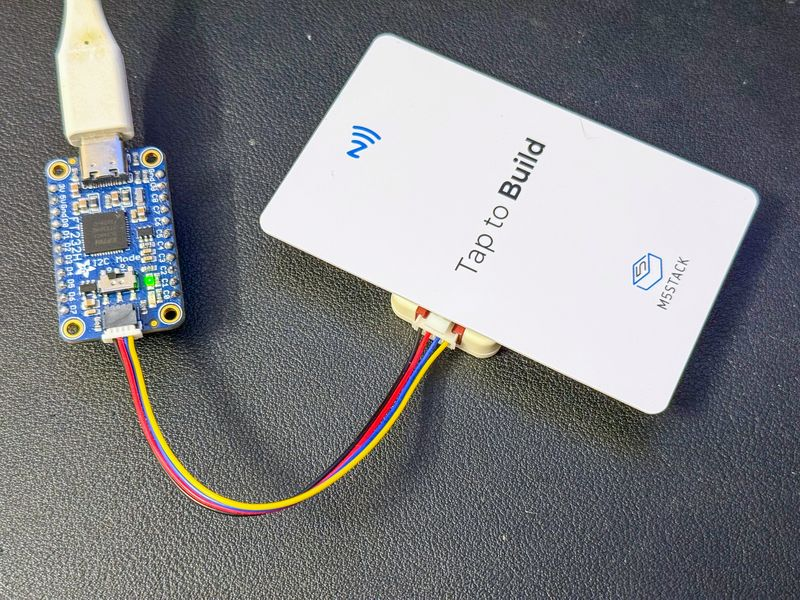

# python: NFC tag reader/writer for the Mac

A command-line tool that reads and writes NTAG215 tags from a Mac. An Adafruit FT232H breakout acts as the I2C master (through `pyftdi`) and talks to an M5Stack NFC Universal Unit (ST25R3916, I2C address 0x50).

```
Mac --USB--> FT232H --I2C--> M5Stack NFC unit --13.56 MHz--> NTAG215 tag
```

## What you need

- [Adafruit FT232H breakout](https://shop.adafruit.com/products/2266) and a USB cable
- [M5Stack NFC Universal Unit (ST25R3916)](https://shop.m5stack.com/products/nfc-universal-unit-st25r3916), SKU U216, with its Grove cable
- NTAG215 tags (stickers or cards)
- macOS with [uv](https://docs.astral.sh/uv/) and libusb: `brew install libusb`

## Wiring






| FT232H | NFC unit (Grove cable) |
|---|---|
| D0 | SCL (white) |
| D1 and D2 tied together | SDA (yellow) |
| GND | GND (black) |
| USB 5V pin | 5V (red) |

D1 and D2 are tied because the FT232H's I2C data line uses two pins: D1 drives data out, D2 reads it back.

The unit's 5V pin feeds an on-board 3.3V regulator, and its I2C pull-ups go to that 3.3V rail. The FT232H's 3.3V signals therefore need no level shifter.

## Check the setup

```
uv run python -m nfc.scan          # expect: OK: NFC unit at 0x50
uv run python -m nfc.cli chip      # expect: ST25R3916 present: type=0x05 revision=2
```

If `scan` finds nothing, check the wiring. `uv run python -m nfc.aht30_check` tests the FT232H's I2C path on its own, using an AHT30 temperature sensor at address 0x38.

## Commands

Run from this folder with a tag lying flat on the unit:

```
uv run python -m nfc.cli <command>
```

| Command | What it does |
|---|---|
| `chip` | Checks that the ST25R3916 answers and prints its type and revision. |
| `detect` | Finds a card and prints its UID, ATQA and SAK, and whether it is an NTAG215. |
| `dump` | Prints all 135 pages (4 bytes each) as hex and ASCII. |
| `read-ndef` | Decodes the NDEF message: text and URI records. Reads a Type 2 tag (NTAG) by pages, or a Type 4 tag over ISO-DEP (it prints `Type 4 tag (ISO-DEP)` first); Python only for the Type 4 read. |
| `write-ndef [--text T] [--lang L] [--uri U]` | Writes a text and/or URI record, replacing the current message. Pages that already match are skipped. |
| `write-page <page> <8 hex digits> [--force]` | Writes one 4-byte page and reads it back to verify. |
| `ident` | NTAG identification: `GET_VERSION`, `READ_SIG` and `READ_CNT` (NTAG21x datasheet 10.1, 10.8, 10.6). Prints the version bytes, the type, the signature and the counter, or `Counter: not readable (NAK)`. A tag that does not answer a command is selected again: if it still answers, the command is reported as refused. |
| `desfire` | Identifies a DESFire card (ISO 14443-4) without keys: ATS, `GET_VERSION` (hardware and software version, storage size, UID, production date) and `GET_APPLICATION_IDS`, with the status words. `detect` points ISO-DEP cards to it. |
| `cycles [N]` | Runs N (default 50) rounds of select and full dump and compares each dump with the first. A full dump takes about 0.7 s here, so 50 cycles take about 40 seconds. |

Options before the command: `--freq` sets the I2C clock in Hz (default 100000) and `--url` sets the pyftdi device URL (default `ftdi://ftdi:232h/1`).

```
$ uv run python -m nfc.cli detect
UID:  04:64:31:66:D3:2A:81
ATQA: 4400  SAK: 0x00
Type: NTAG215

$ uv run python -m nfc.cli write-ndef --text "hello" --uri https://example.com
wrote 8 page(s)

$ uv run python -m nfc.cli read-ndef
text[en]: hello
uri: https://example.com
```

Errors print as `error: ...` on stderr and the exit status is 1.

### Which pages can be written

User memory is pages 4 to 129 (504 bytes). Writes outside that range, such as the UID, lock bytes, capability container (page 3) and configuration pages, are refused unless you pass `--force`. Their bits are one-way: a lock bit cannot be cleared again. Use a spare tag when you experiment with them.

## Acting as a tag

`tools/listen_probe.py` puts the chip in NFC-A target mode so a phone can read and write it, then prints what the phone did:

```
uv run python tools/listen_probe.py [seconds] [t2|t4|sniff]
```

`t2` (default) is an NTAG215, `t4` an NFC Forum Type 4 NDEF tag, `sniff` an ISO-DEP card that logs every APDU (UID `04112233445566`). The listener is `nfc/listen.py`, the tag models are `nfc/type2tag.py`, `nfc/isodeptarget.py` and `nfc/apduapps.py`, all ported from [`../arduino`](../arduino/README.md#acting-as-a-tag-card-emulation).

A phone gives a tag about 5 ms to answer. This first failed through the FT232H because `pyftdi` does one USB round trip per I2C byte: one reply took about 8 ms and a whole Type 2 command 11 ms. `FtdiTransport.batch()` in `nfc/transport.py` builds the same MPSSE command stream as raw batches, one USB write and one read per step, and checks the acknowledgements afterwards. The listener sends the poll, the frame read and the reply this way, and so the state changes between the select and the first command (`READY`, `ACTIVE`, `HALT`). A whole Type 2 command takes about 1.7 ms (`tools/batch_timing.py` measures it). The bus has to run at 400 kHz: at 100 kHz the bytes alone take too long. The batch reaches into `pyftdi`'s private `I2cController` helpers; the version is pinned in `uv.lock` (0.57.2) and `tests/test_batch.py` checks the command shape.

Checked with an iPhone and NFC Tools on 21 Nov 2026: `t2` was identified as an NTAG215 and took a text record (25 frames answered, 7 tag writes); `t4` took a text record through the Type 4 NDEF file and the phone read it back (37 frames). `sniff` not run. It needs a quiet USB bus: a macOS USB hiccup longer than a few milliseconds makes the phone drop the field.

## Peer-to-peer: exchange an NDEF message with another NFC device

The unit can also be the initiator of an NFC-DEP link (peer-to-peer) and receive or send an NDEF message over LLCP and SNEP. Three scripts in `tools/`:

```
uv run python tools/dep_probe.py [tries]            # link layer only
uv run python tools/snep_receive.py [seconds] [--idle S]   # receive a SNEP Put and decode it
uv run python tools/snep_send.py [text] [--uri URL] [--seconds S]   # send a SNEP Put
```

`dep_probe.py` selects the peer like a Type A card (it must advertise NFC-DEP: SAK bit 6, `0x40`), sends `ATR_REQ`, prints the `ATR_RES`, then exchanges a few LLCP SYMM PDUs in `DEP_REQ` / `DEP_RES` and releases the link. It answers the peer's `S(RTOX)` timeout-extension requests; a peer whose host is slow asks for one on almost every exchange, and the next exchange fails if it is ignored.

`snep_receive.py` adds an LLCP server: it answers a `CONNECT` to the SNEP service (`urn:nfc:sn:snep`, SAP 4) with `CC`, acknowledges `I` PDUs, answers a fragmented SNEP Put with Continue and a complete one with Success, answers `DISC` with `DM`, and decodes the NDEF message with `nfc.ndef`. If the peer sends only SYMM for `--idle` seconds (6 by default) it releases the link and starts again.

`snep_send.py` is the other direction: an LLCP client. It sends a SYMM first to tell the peer's phase (a SNEP server answers SYMM, a SNEP client answers with its own CONNECT, and the script then releases and retries), sends `CONNECT` to the SNEP service by name, sends the NDEF message (a Text record, or a URI record with `--uri`) as one SNEP Put in one `I` PDU, polls with SYMM until the peer's Success arrives and acknowledges it with `RR`.

**Peer used:** a PN532 module running the `p2p_raw` example of the Seeed PN532 Arduino library, which makes it an NFC-DEP target and a SNEP client. Hold its antenna against the unit. Phones are no use as a peer: Android Beam was removed from Android and iPhones do not do peer-to-peer.

**Result** (22 Nov 2026, FT232H at 400 kHz): `dep_probe.py` printed the `ATR_RES` in 31.8 ms (peer response timeout about 155 ms, LLCP 1.0 general bytes) and four DEP exchanges. `snep_receive.py` printed `media text/plain: 'hello world'`, the 24-byte message in the sketch, on 2 of 2 runs. It takes about 20 s: `p2p_raw` alternates a write phase (the PN532 is the SNEP client and sends the CONNECT and the Put) and, after a 3 s delay, a read phase (the PN532 is a SNEP server and waits for the other side to CONNECT). `snep_receive.py` only serves the write phase, so it releases and retries until it lands in it. `snep_send.py` needs the read phase and does the same: it printed `SNEP response 81 = Success` on attempt 1 and the PN532 printed `...T.enhello from the unit` on its serial port (a 26-byte Text record).

Timing is easy as an initiator: the peer's response timeout comes in the `ATR_RES`, so the FT232H needs no batching here (the target role, as in "Acting as a tag", has the 5 ms limit).

**Limits:** a Put that fits one `I` PDU when sending (the PN532 sketch reads 128 bytes; no fragmentation on send); one peer, tested with a PN532 only; the packet bytes were checked offline for the CC, I and DM PDUs and a fragmented Put, but there are no host tests in `tests/` yet. The other folders do not have peer-to-peer.

## Supported tags and limits

- Reading and writing work for NTAG215 and other Type 2 tags with 4- or 7-byte UIDs. Only NTAG215 has been tested.
- `detect` identifies any ISO 14443-A card by UID, ATQA and SAK, but cannot read the content of other card types. DESFire cards (SAK `0x20`, for example an ORCA card) can be identified with `desfire` (ATS, version, application IDs; no keys, so no file contents).
- A full 135-page dump takes about 0.7 seconds (select and dump alone about 0.5 s). It took 7 s until the FTDI latency timer was lowered from its 16 ms default to 1 ms in `nfc/transport.py`: every I2C operation waits for one timer tick, about 1 ms now instead of 18 ms. It is still slower than the Feather folders because every I2C transfer goes through USB.
- Each command takes about 5 s longer to exit, because closing the FTDI device (`pyftdi`) is slow. The cause is not found.

## Is a tag genuine NXP?

`ident` prints `Type: NTAG215 (NXP)` from the `GET_VERSION` bytes, and a clone can copy those. Two other checks tell more:

- The first UID byte is the manufacturer code. NXP is `04`.
- `READ_SIG` returns a 32-byte ECDSA signature over the UID that verifies against NXP's public key (secp128r1, NTAG21x datasheet 10.8). `ident` prints it but does not verify it. A reply that repeats pages 0-3 means the tag has no signature.

Tags checked on 2026-11-19, with the iPhone app NFC Tools as a second opinion:

| Tag | Reports | UID byte 0 | `READ_SIG` | Memory |
|---|---|---|---|---|
| M5Stack card | NTAG215 (NXP) | `04` | pages 0-3 twice; NFC Tools: signature invalid | not tested |
| SwitchBot NFC tag stickers (Amazon) | NTAG216 | `1D`, Shanghai Fudan | 32 bytes, not NXP-signed | full 231 pages (888 bytes user) |
| Gusruvti NTAG213 stickers (Amazon) | NTAG213 | `53`, Shanghai Feiju | pages 0-3 twice | full 45 pages (144 bytes user) |

All three read, write and hold their NDEF like NTAG21x, and the two Amazon listings do not claim NXP. The memory test wrote a marker to the last user page and restored it, and read past the end of memory (a real NTAG wraps at the last page and refuses the next block). Never write page 40 on an NTAG213 (page 226 on an NTAG216): those are the dynamic lock bytes, and set bits cannot be cleared.

## Diagnostics

`uv run python tools/probe_nfc_b.py` checks whether a card couples to the reader and whether it answers on NFC-A or NFC-B (antenna amplitude and phase, WUPA, REQB and WUPB; the Mac speaks cues for what to put on the unit). It was written for a US passport that did not answer in any position: the reader coupled to its antenna but no chip answered on either mode. The script's docstring has the details and the limits of that result.

## How it works

| File | Role |
|---|---|
| `nfc/transport.py` | `FtdiTransport`: I2C writes and write-then-read exchanges through pyftdi. |
| `nfc/st25r3916.py` | The chip driver: registers, FIFO, direct commands, initialisation, field control, `transceive`. |
| `nfc/nfca.py` | ISO 14443-A: CRC_A, WUPA, anticollision, select, Type 2 READ and WRITE. |
| `nfc/ident.py` | NTAG `GET_VERSION`, `READ_SIG`, `READ_CNT`, the type names and the counter. |
| `nfc/isodep.py` | ISO 14443-4 block protocol: RATS, I-block framing, chaining, waiting-time extension, retries, deselect, plus the DESFire command wrapper. Ported from the C++ layer (itself a port of embassy-rs/rnfc); the same code runs in `../micropython`. |
| `nfc/ntag215.py` | The tag's memory model: 135 pages, write guards, NDEF read and write. |
| `nfc/ndef.py` | NDEF text and URI records and the TLV wrapper. |
| `nfc/cli.py` | The commands above. |
| `nfc/scan.py`, `nfc/aht30_check.py` | Setup checks. |

Behaviour of the chip worth knowing:

- After a checked receive, the chip leaves the CRC_A bytes in its FIFO. `transceive` strips them when they match.
- A tag's 4-bit write acknowledgement trips the chip's CRC and parity flags. The write path ignores those flags for that one frame, but accepts the reply only if it is exactly one byte ending in an incomplete byte (the chip's `fifo_lb` field is non-zero). That is the rule ST's RFAL library uses; the reply format is defined in the NTAG21x datasheet, section 9.3.
- A tag that is already selected ignores WUPA until the field is power-cycled. `select_card` resets the field and retries once when WUPA gets no answer, so repeated selects work.
- The Grove connector has no interrupt pin, so the driver polls the chip over I2C and uses the chip's own no-response timer to end waits.

## Tests

```
uv run --with pytest python -m pytest -q
```

50 tests run the stack against a software fake chip (`tests/fakechip.py`) or a scripted card and need no hardware: the whole read and write path, `ident` with its NAK cases, the `cycles`, `detect` and `desfire` commands, the ISO-DEP framing (every ISO 14443-4 Annex B scenario), the tag emulation state machine and the shape of the batched MPSSE commands. Run them with `uv run --with pytest python -m pytest -q tests`.

On hardware (2026-11-14, NTAG215 and an ORCA DESFire card on the FT232H): `ident`, NDEF write and read, page writes and the refused-page guard, `cycles 50` (50 of 50 dumps at about 7.1 s each) and `desfire` all pass, with the same output as the Feather variants.

## Same functionality elsewhere in this repo

[`../micropython`](../micropython), [`../arduino`](../arduino), [`../tinygo`](../tinygo) and [`../rust`](../rust) turn a Feather RP2350 and the same NFC unit into a USB smart-card reader that any PC/SC tool on the Mac can use, with the same commands as this tool on the board's serial port.
