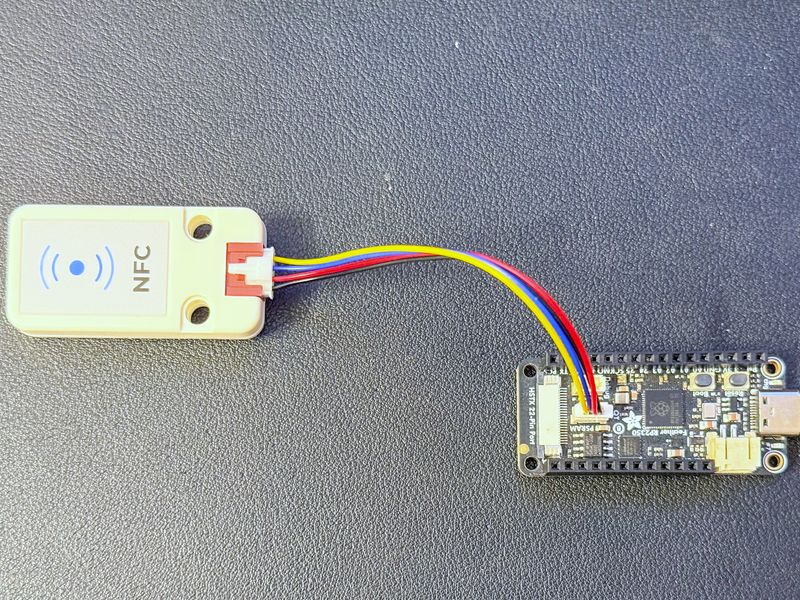

# tinygo: USB NFC reader and serial tool on a Feather RP2350, in Go

Go firmware ([TinyGo](https://tinygo.org/)) for an Adafruit Feather RP2350 and an M5Stack NFC Universal Unit (ST25R3916). It does the same two things as [`../arduino`](../arduino), over the Feather's one USB cable:

- **A USB smart-card (CCID) reader.** The Mac sees a standard PC/SC reader, so `pyscard`, OpenSC and `pcsctest` work with it.
- **A serial command line** (`chip`, `detect`, `dump`, `read-ndef`, `write-ndef`, `write-page`, `ident`, `desfire`, `cycles`, `emulate`, `emu-dump`).

```
Mac --USB: CCID reader + serial--> Feather RP2350 --I2C (Qwiic)--> M5Stack NFC unit --13.56 MHz--> NTAG215 tag
```

The chip logic is ported from `../arduino/src` (itself ported from `../python`), with [M5Unit-NFC-Go](https://github.com/nicolasmmb/M5Unit-NFC-Go) as the reference for the init sequence. Nothing is imported from it.

## What you need

- Adafruit Feather RP2350 (PSRAM/HSTX model), a USB cable, a Qwiic cable
- M5Stack NFC Universal Unit (ST25R3916), NTAG215 tags
- On the Mac: Go and TinyGo (`brew install go tinygo`)

Wiring is the same as `../arduino`: the unit goes into the Qwiic port (I2C1, SDA GP2, SCL GP3).



## Build and flash

TinyGo 0.41 has no `feather-rp2350` target; the `pico2` target runs on the same RP2350 chip and `main.go` sets the Qwiic pins itself.

TinyGo 0.41 accepts Go 1.19 to 1.26 only. With a newer Go installed, pin the toolchain:

```
export GOTOOLCHAIN=go1.26.0
tinygo build -target=pico2 -o nfc.uf2 .
```

Hold BOOTSEL while plugging the Feather in (the `RP2350` drive appears), then copy the file:

```
cp nfc.uf2 /Volumes/RP2350/
```

`tinygo flash` did not work here: it cannot reset the board into the bootloader by itself, so flash by copying the file.

## Use it

### As a PC/SC reader

Same APDUs, status words and ATR as [`../arduino`](../arduino/README.md#as-a-pcsc-reader):

| APDU | Meaning | Reply |
|---|---|---|
| `FF CA 00 00 <Le>` | UID | UID + `90 00` |
| `FF B0 00 <page> <Le>` | Read `Le` bytes from `page` (`Le` = 0 reads 16), up to 255 | data + `90 00` |
| `FF D6 00 <page> 04 <4 bytes>` | Write one page, then read it back | `90 00` |
| `FF 60 00 00 00` | NTAG `GET_VERSION` | 8 bytes + `90 00` |
| `FF 3C 00 00 00` | NTAG `READ_SIG` | 32 bytes + `90 00` |
| `FF 39 00 02 00` | NTAG `READ_CNT` | 3 bytes + `90 00`, or `6A 81` if the tag refuses |
| anything else, card is ISO-DEP | passed to the card unchanged; the card's reply and status words come back | card's reply |

For an ISO-DEP card (a DESFire card, for example) power-on also runs RATS and answers with an ATR built from the card's ATS (`3B 81 80 01 80 80` for a DESFire EV1). The card then stays activated between APDUs, so DESFire native commands wrapped as `90 INS 00 00 00` work, including the "additional frame" chain across separate commands; `FF CA` is still answered by the reader. A serial command that selects the card ends that session (the next PC/SC command fails and the host connects again), and while an ISO-DEP card is powered the reader does not probe for it, so a removed card is noticed on the next command instead of through a slot-change event. Only unauthenticated commands were tried; there is no key handling.

```
opensc-tool -s 9060000000 -s 90AF000000 -s 90AF000000    # GET_VERSION in three frames
```

Check it with the scripts in [`../micropython`](../micropython) (`uv run --with pyscard python <script>`): `pcsc_check.py`, `pcsc_monitor.py`, `pcsc_ndef_roundtrip.py`.

### As a serial command line

Open the Feather's USB serial port at 115200 baud. The board waits 3 seconds after power-up. The commands are identical to [`../arduino`](../arduino/README.md#as-a-serial-command-line); each ends with `ok` or `error: ...`. Pages outside user memory (4 to 129) are refused unless `--force`; those bits are one-way.

## Source layout

| File | Role |
|---|---|
| `nfc/st25r3916.go` | Chip driver over a `Transport` interface (registers, FIFO, `Transceive`). |
| `nfc/nfca.go` | CRC_A, WUPA, anticollision, select, Type 2 READ and WRITE. |
| `nfc/ntag215.go` | Memory model, write guards with read-back, NDEF read and write. |
| `nfc/isodep.go` | ISO 14443-4 block protocol: RATS, I-block framing, chaining, waiting-time extension, retries, deselect, plus the DESFire command wrapper. Ported from `../arduino/src/IsoDep.cpp` (itself a port of embassy-rs/rnfc) and tested against the ISO 14443-4 Annex B scenarios in `go test`. |
| `nfc/ident.go` | NTAG `GET_VERSION`, `READ_SIG`, `READ_CNT`, the type names, and the NAK mapping for refused writes. |
| `nfc/listener.go`, `nfc/target.go`, `nfc/type2tag.go`, `nfc/isodeptarget.go`, `nfc/apduapps.go`, `nfc/emulate.go` | Tag emulation (`emulate [S] [t2|t4|sniff]`, `emu-dump`): the chip's target-mode state machine, an NTAG215 model, an ISO-DEP target with a Type 4 NDEF app and an APDU sniffer. Ported from `../arduino/src` with the same tests in `go test`. Checked with an iPhone and NFC Tools on 21 Nov 2026: `t2` was identified as an NTAG215 and took a text record (22 frames answered); `t4` took a text record through the Type 4 NDEF file and the phone read it back (37 frames). `sniff` not run. |
| `nfc/ndef.go` | NDEF text and URI records, TLV wrapper. |
| `nfc/cli.go` | The serial command line (takes an `io.Writer`, so it runs on the host too). |
| `nfc/backend.go` | Maps the pseudo-APDUs above onto the tag. |
| `ccid/proto.go` | CCID message layer. No USB or chip dependency. |
| `ccid/usb.go` | The USB class driver (TinyGo only, build tag `tinygo`). |
| `main.go` | I2C1 transport, registers CCID, runs the CLI and the CCID service loop. |

### How the USB CCID reader works

TinyGo's USB stack lets a program replace the configuration descriptor and register endpoints with `machine.ConfigureUSBEndpoint`, which is what its mass-storage class does. `ccid/usb.go` copies the CDC-plus-extra-interface layout from `usb/msc` and puts a CCID interface (class 0x0B, bulk in and out, interrupt in) at interface 2, endpoints 4 to 6. `ccid.Begin` runs before the 3-second wait so the host sees the interface at enumeration. The receive handler runs in the USB interrupt and only stores the message and withholds the ACK; `Service`, called from the main loop, does the I2C work, sends the reply in 64-byte packets (plus a zero-length packet for exact multiples), acknowledges the OUT transfer, and polls for a card every 300 ms to send slot-change notifications.

## Tests

```
go test ./nfc ./ccid     # host: CRC_A, NDEF round trip, tokenizer, CCID message layer
```

On hardware, with a tag on the unit (2026-11-13): `chip`, `detect`, `dump`, NDEF write and read, and `cycles 50` give 50 of 50 full dumps at about 184 ms each. Over PC/SC: ATR, UID, page reads, refused lock-page write, NDEF round trip, and insert and remove events all pass. A 255-byte read takes about 64 ms. `ident`, the three identification APDUs and the NAK messages were added on 2026-11-14 and checked the same way (`cycles 20` 20/20 at 183 ms); a refused write was not provoked on hardware. `desfire` was checked on a MIFARE DESFire EV1 4K (ORCA card): the ATS, version and application IDs match the Arduino and Rust variants.

## Limits

- Type 2 tags can be read and written. DESFire cards can be identified with `desfire` and passed through the PC/SC reader (no keys, so no file contents).
- The reader has no product string yet, so macOS shows it as `11914 10` (USB vendor and product ID).
- No fake-chip test for the driver (the Python variant has one), only hardware runs.
- Serial commands and the PC/SC reader share the chip; a long `cycles` delays PC/SC answers.
- Only one firmware can be on the Feather at a time.
